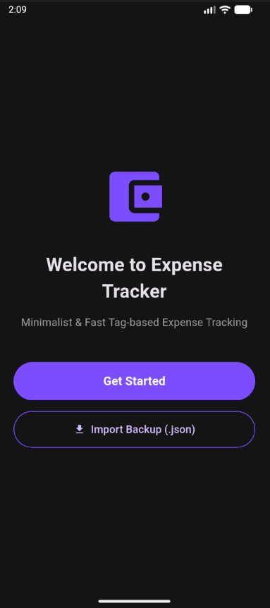
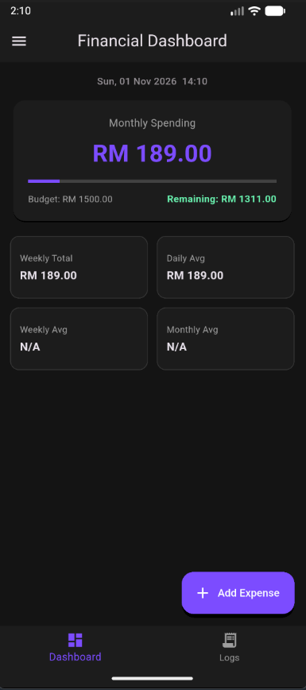
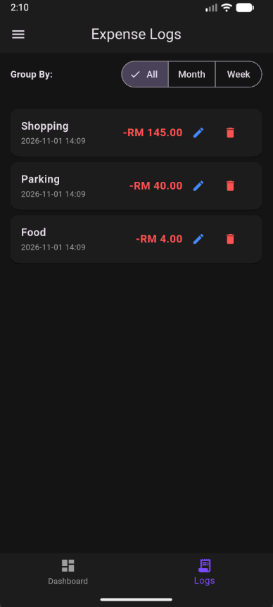
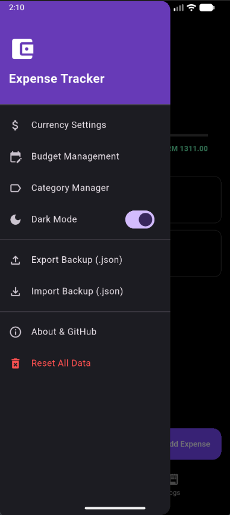

# Expenses Tracker

A cross-platform personal finance and expense tracking application built with Flutter. Designed to help users record daily transactions, monitor spending habits, and manage financial data locally.

---

## 📱 Features

- 💰 **Expense & Income Tracking**: Quickly log, edit, and categorize daily financial transactions.
- 📊 **Visual Analytics**: Interactive charts to analyze category-wise spending and monthly trends.
- 🌓 **Theme Customization**: Built-in light and dark mode options.
- 💾 **Data Backup & Restore**: Import and export local financial records (JSON/CSV) anytime.

---

### 🖼️ Preview (Not the lastest version)
<table align="center">
  <tr>
    <td align="center" width="50%">
       
    </td>
    <td align="center" width="50%">
       
    </td>
  </tr>
  <tr>
    <td align="center" width="50%">
       
    </td>
    <td align="center" width="50%">
       
    </td>
  </tr>
</table>

---

## 🚀 Installation

### Android
1. Go to the [Releases](../../releases) section of this repository.
2. Download the latest `ExpenseTracker.apk`.
3. Transfer the `.apk` to your Android device (or drag and drop it into an Android Emulator).
4. Tap the file to install and start using the app.

### Windows
1. Download the `ExpenseTracker-Setup-v1.0.0` installer from the [Releases](../../releases) section.
2. Run the installer and follow the on-screen setup wizard.
3. Launch the application from your Start Menu or Desktop shortcut.

---

## 🛠️ Built With

- **Framework**: [Flutter](https://flutter.dev/) (Dart)
- **State Management & Storage**: `shared_preferences`, `path_provider`
- **File System Handling**: `file_picker`

---

## 📄 License

This project is licensed under the [MIT License](LICENSE).
